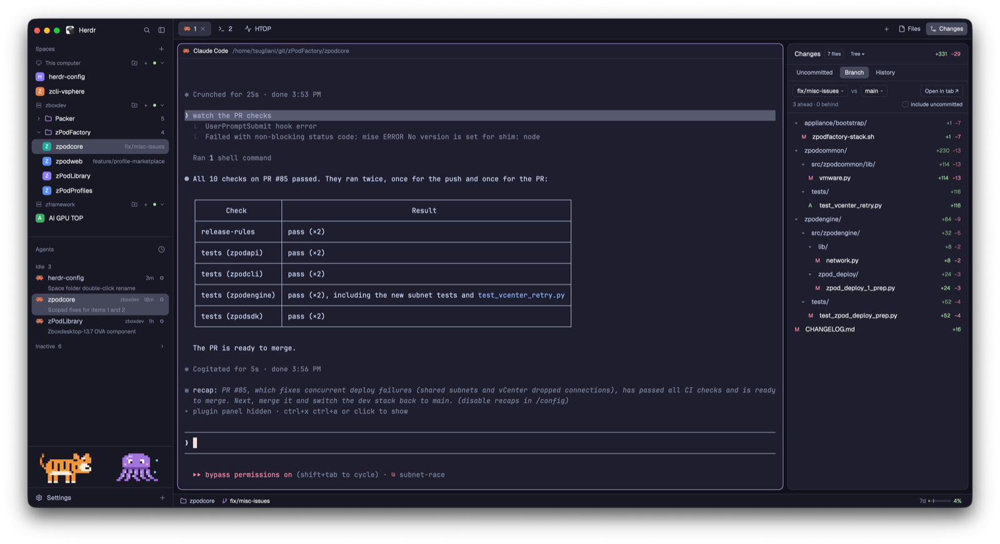

# herdr-tsugliani-git

My [Herdr](https://herdr.dev) setup: Herdr's main layout, with a Changes panel
that also compares branches and browses history, and a full-tab diff viewer.



## What's in it

One layout, ten mods and a theme. The layout places the mods; each mod is one
piece of the window and works on its own.

### Layout: `herdr-tsugliani-git`

`layouts/herdr-tsugliani-git.json`, Herdr's main layout rearranged around git
and agents:

```
┌──────────────┬────────────────────────────────────────────────────────┐
│ brand        │ tabs                                                   │
├──────────────┼─────────────────────────────────────────┬──────────────┤
│ spaces       │                                         │  Files /     │
│              │  terminal panes                         │  Changes     │
├──────────────┤                                         │  panel       │
│ agents       │                                         │  (hidden     │
├──────────────┤                                         │  until you   │
│ tiger·octopus│                                         │  open it)    │
├──────────────┼─────────────────────────────────────────┴──────────────┤
│ footer       │ session bar                                            │
└──────────────┴────────────────────────────────────────────────────────┘
```

- **Sidebar** (268 px): the logo row, then the spaces and agents lists sharing
  the height, the two pixel-art creatures, and the Settings footer.
- **Work area**: the tab bar over Herdr's terminal panes.
- **Right panel** (368 px, hidden until you open it): Herdr's own Files panel,
  or the Changes panel below. The **Files** and **Changes** buttons in the tab
  bar switch between them.
- **Session bar** (28 px): along the bottom of the work area, in place of
  Herdr's status bar.

### Mods

#### `herdr-tsugliani-changes`: Changes panel

The right panel's git view, with three tabs:

- *Uncommitted*: what Herdr's own Changes panel shows, with the commit box.
- *Branch*: your branch against a base, like `git diff main...HEAD`. Pick
  either side from your local and remote branches, and optionally include
  uncommitted work.
- *History*: the last 300 commits; open one to see its files and diffs.

Files show as a folder tree or a flat list. The panel shows no diffs itself:
clicking a file shows its diff in a preview tab, reused for the next click.
**Open in tab ↗** opens the whole diff, every file, in a tab.

#### `herdr-tsugliani-diff`: diff tabs

The tab the Changes panel opens a diff in. Not in the layout: it opens as a
tab. Inline by default, or side by side (**View** button, remembered for every
tab). Click a file header to fold it; `n`/`p` (or `j`/`k`) go to the next or
previous file, `r` refreshes. Diff tabs reload when the branches or your
uncommitted work change, and uncommitted diffs include new, untracked files.
See [Install](#install) to open one from a shell.

#### `herdr-tsugliani-spaces`: spaces with folders

A clone of Herdr's spaces list that adds **folders** inside each machine's
section. The folder button in a machine's header (or in the Spaces header when
there's only this computer) makes one and asks for its name. Click a folder to
fold it; right-click it to rename or delete it (its spaces just come back out).
Drag a space onto a folder, or onto a space inside one, to put it in; drag it
onto a loose space, or onto "Out of folder" while dragging, to take it out.

Each machine keeps its folders next to its spaces, in a small document on its
own Herdr core. Every device connected to a machine with this repo installed
shows the same folders, and a change on one shows on the others within
seconds. Herdr without this repo shows the same spaces as a plain list. Folded
or open is per screen.

#### `herdr-tsugliani-agents`: agents list

A clone of Herdr's agents list. An agent's title goes on a second line under
its space name, the full width of the row, instead of being squeezed beside the
name and cut short. Agents idle for two hours (not pinned, not the one you're
on) move to an **Inactive** section at the bottom, faded and folded until you
open it; any activity brings them back.

#### `herdr-tsugliani-tabs`: tab bar

A clone of Herdr's tab bar that shows when a shell tab is running a command: a
spinner in the accent color takes the icon's place, and a tab Herdr numbered
shows the command beside its number (`⟳ 2 · build.sh`) until it ends. A tab you
named keeps its name; hovering the spinner names the command. The command is
the title your shell gave it, else its command line. Agents keep Herdr's own
working spinner. Editors, pagers, monitors and `ssh` don't count, since you sit
in those for hours.

#### `herdr-tsugliani-session-bar`: session bar

The bottom bar, from
[cybertron288/herdr-mods](https://github.com/cybertron288/herdr-mods/tree/main/session-bar)
(MIT).

**Left:** the focused pane's folder, branch, commits to push and pull, changed,
staged and conflicted files, and stashes. The changed chip opens the Changes
panel. It works on remote machines too: git runs where the space is.

**Right:** Claude Code's usage, drawn after
[nozikov/herdr-usage-limits](https://github.com/nozikov/herdr-usage-limits)
(MIT).

- The account's 5-hour and weekly limits, whatever pane is focused. Each is a
  bar with a tick for the time already passed (bar past the tick: you're using
  it up too fast): green under 70%, amber from 70%, red from 90%, with the time
  to reset from amber on.
- While the focused pane runs Claude Code, also its model, effort and context
  meter (amber from 80%, red from 95%).
- After the model, its writing speed (`63 tok/s`), estimated per reply. Claude
  Code reports no speed, so it is the reply's output tokens over the time spent
  waiting for it, first token and thinking included. Replies under 100 tokens
  (mostly tool calls) are left out.

Rest the pointer on them for the full card, which adds the session's average
speed; a reading older than 15 minutes is dimmed.

No plugin: Claude Code's own status line feeds it. `./herdr.sh install` points
`statusLine` in `~/.claude/settings.json` at the mod's `claude-statusline.sh`
(needs `jq`), which writes the numbers to `~/.local/state/herdr-session-bar/`
and then hands the same JSON to Orca's status line script, if Orca installed
one. Numbers appear after each session's next reply (Claude Code reads the
setting on the fly). `./herdr.sh uninstall` puts the previous `statusLine`
back.

#### `herdr-tsugliani-brand`: logo row

The sidebar's top row: the Herdr logo, search, and the sidebar toggle. It
leaves room for the macOS window buttons at any zoom; Herdr's own puts the logo
under them below zoom 1.

#### `herdr-tsugliani-footer`: sidebar footer

The sidebar's bottom row, on one line: Settings, and Add machine as a `+` at
its right end.

#### `herdr-tsugliani-tiger` and `herdr-tsugliani-octopus`: pixel-art creatures

A small row above Settings with two creatures side by side: a tiger that
breathes, swishes its tail and blinks, and a purple octopus that bobs, ripples
its tentacles, blinks and lets bubbles rise. No image and no timer: each pixel
is a block glyph of JetBrains Mono, one text layer per color, stepped natively
by Herdr's frame clock, so they stay crisp at any zoom and shrink with the
sidebar.

### Theme: `herdr-tsugliani-theme`

**Catppuccin Mocha** (`themes/herdr-tsugliani-theme.json`): the official
palette for terminals, and Herdr's panel colors mapped onto it (mantle bars,
crust canvas, mauve accent). The layout doesn't set it; `./herdr.sh install`
switches to it, and Settings > Look picks another.

## Install

Needs Herdr running at least once (it creates `~/.config/herdr-app`).

```sh
git clone <this repo> && cd herdr-config
./herdr.sh install        # copies layouts/, themes/ and mods/ into Herdr and switches to herdr-tsugliani-git and Catppuccin Mocha
```

`ctrl-shift-l` (`cmd-shift-l` on macOS) cycles back to your previous layout.
`./herdr.sh uninstall` removes everything this repo installed.

Installing never overwrites a different file of the same name: it stops and
lists them. `./herdr.sh install --force` replaces them and keeps a copy in
`~/.config/herdr-app/backups/<time>/`.

Open a diff tab from a shell:

```sh
herdr-app do tab.new '{"mod":"herdr-tsugliani-diff","name":"diff main","props":{"folder":"/path/to/repo","base":"main"}}'
```

Props: `folder`, `on` (a machine from `hc machine ls`), `base`, `compare`
(default `HEAD`), `withWork`, `commit`, `working`, `file` (only that file).
Without `folder` it uses the space's first terminal; without `base`, `main`
or `master`.

## Changing it

Herdr hot-reloads files in `~/.config/herdr-app`, not in this repo (it
doesn't reload a symlinked mod folder), so:

- edit the installed copy (or ask an agent to: Herdr's `AGENTS.md` points it
  there), then `./herdr.sh pull` to bring the change here and commit it, or
- edit here, then `./herdr.sh install --force`.

`./herdr.sh status` shows what differs between this repo and Herdr.
`node --test` tests the diff parser (`mods/herdr-tsugliani-diff/diff.js`), the
tiger's and octopus's frames (`sprite.js` in their mods), the tab bar's running
check (`mods/herdr-tsugliani-tabs/running.js`), the spaces folders
(`mods/herdr-tsugliani-spaces/folders.js`) and the session bar's
status line script and usage helpers (`mods/herdr-tsugliani-session-bar/`).

## Sharing on herdr.dev

The repo is laid out as a Herdr layout (`layouts/`, `themes/`, `mods/`,
`RECIPE.md`, `preview.png`). The preview is the layout in use, with the
Catppuccin Mocha theme. Push it to a public GitHub repo and add the topic
`herdr-layout`; it shows up at herdr.dev/layouts within the hour.

## Credits

Built on other people's work:

- **[Herdr](https://herdr.dev)**: the layout starts from Herdr's `main` layout
  (0.1.13). `herdr-tsugliani-changes`, `-spaces`, `-agents` and `-tabs` are
  clones of Herdr's shipped `changes`, `spaces`, `agents` and `tabs` mods, and
  `herdr-tsugliani-brand` and `-footer` are split from its `workspace-chrome`
  mod (all 0.1.13). Each mod's `mod.json` records what it was cloned from.
- **[cybertron288/herdr-mods](https://github.com/cybertron288/herdr-mods/tree/main/session-bar)**:
  `herdr-tsugliani-session-bar` is its `session-bar` mod (at `34e7c33`, MIT,
  its `LICENSE` kept in the mod folder), renamed and extended with the Claude
  Code usage. `RECIPE.md` lists what changed from upstream.
- **[nozikov/herdr-usage-limits](https://github.com/nozikov/herdr-usage-limits)**
  (MIT): the session bar's usage meters and their card follow its design.
- **[Catppuccin](https://github.com/catppuccin/catppuccin)** (MIT): the theme
  is its Mocha palette.
- **[JetBrains Mono](https://github.com/JetBrains/JetBrainsMono)** (OFL 1.1),
  bundled with Herdr: the tiger and octopus are drawn with its block glyphs.
