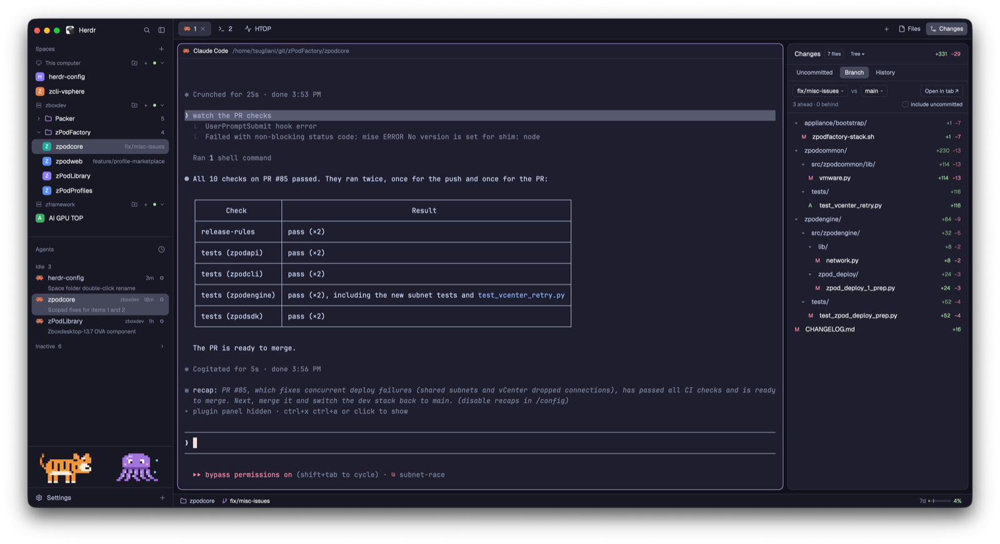

# herdr-tsugliani-git

Herdr's main layout, made for reviewing git work. The right-hand Changes panel
lists what changed — uncommitted work, everything your branch changes against a
base branch (`main...HEAD`), or any commit in the history — as a folder tree.
Clicking a file shows its diff in a tab; **Open in tab** shows every file. Diff
tabs are inline or side by side, foldable.

The preview shows it with the bundled Catppuccin Mocha theme
(`themes/herdr-tsugliani-theme.json`); the layout doesn't set it, `herdr.sh install`
does (`app.theme`).

## What you see

Left to right, as in Herdr's `main` layout: the spaces and agents sidebar,
the tab bar over the shown tab, and the side panel (368px; 280–900px, hidden
until the tab bar's **Changes** button opens it). Only the panel's content and
the diff tab are new. Everything uses theme colors (`background`, `chrome`,
`raised`, `border`, `selected`, `hover`, `accent`, `muted`, `dim`; added
lines `ansi2`, removed `ansi1`, modified `blocked`).

**Changes panel** (`herdr-tsugliani-changes`), top to bottom:
1. Header, 42px: "Changes", a badge with the file count (or commit count in
   History), a **Tree ▾ / List ▾** toggle, then the total `+added −removed`.
2. Mode bar, 34px: **Uncommitted**, **Branch**, **History** (selected one on
   `selected`); in Uncommitted with changes, **Open in tab ↗** on the right.
3. Mode row:
   - Branch: two chips, `<compare> vs <base>`, each with ▾, then **Open in
     tab ↗**; below, 11px: `N ahead · M behind` and an "include uncommitted"
     checkbox (only when comparing `HEAD`).
   - History with a commit open, 34px: **← Commits**, the short hash in
     `accent` monospace, the subject, **Open in tab ↗**.
4. File list, rows 28px, filling the rest of the panel (no diff in the panel):
   status letter (A green, D red, M amber, U red), name, `+n −n`. In tree
   mode, folders (▾/▸, `name/` in `muted`, totals, file count when folded),
   indented 14px a level; a folder holding only one folder shares its row
   (`src/e2e/`). In list mode, the folder path in `dim` before the name.
   The last file clicked is on `selected`.
5. Uncommitted only: a commit message field and **Commit** button.

In History with no commit open, 3–4 are replaced by the commits: subject on
top, `hash · author · when` below, an `accent` dot on commits the base
doesn't have, "· merge" on merges. Picking a branch chip replaces them with a
filter field and the local and remote branches, most recent commit first.

**Diff tab** (`herdr-tsugliani-diff`): a 44px bar on `chrome` with the title
(`e2e-unit-tests vs main`, a commit's `hash subject`, `branch · uncommitted`,
or for one file its path), `N commits ahead, M behind · K files` (one file:
what is compared), `+a −d`, and buttons **Include uncommitted**, **View:
Inline / View: Side by side**, **Collapse all / Expand all** (not for one
file), **Refresh**. Below,
one scrolling list of 22px rows: a file header on `raised` (▾/▸, status,
path in semibold, `+n −n`), hunk headers on `surface`, then lines with old
and new line numbers (40px each), the `+`/`-` sign, and the text, added and
removed lines tinted with `ansi2`/`ansi1` at alpha `1c`. Side by side, each
row is split in two by a 1px `border` line: old line number and removed text
on the left, new on the right, unchanged lines on both, an empty half on
`surface`.

**Agents list** (`herdr-tsugliani-agents`): Herdr's own, except that in the
Priority view (and for pinned agents) a row is two lines, 44px: the space name
in `foreground` (`muted` when idle) with the machine, age and status on the
right, then the agent's title on its own line in `dim` at 11.5px, the full
width of the row, indented 25px past the program icon. Grouped by space, rows
stay one line of 30px.

**Critters row** (`critters`): 84px high, between the agents list and the
sidebar footer (one 41px row: Settings, and Add machine as a `+` at its right
end), split in two equal blocks, `tiger` and `octopus`, each on `chrome` with a
1px `border` line on top.

**Tiger** (`herdr-tsugliani-tiger`): centered in its half, a 30×16-pixel tiger
at 4px a pixel (120×64),
facing right: orange `#f0963c`, black `#1c1a1f` stripes, eye, nose and mouth,
cream `#f6ecd8` muzzle, belly and paws (`#e3d3b3` in a light theme), pink
`#e8a0a8` ears, dark-orange `#b85f1e` rings and tip on the tail.

**Octopus** (`herdr-tsugliani-octopus`): centered in the other half, a 24×16
octopus at 4px a pixel (96×64), facing you: a purple `#a374db` dome head with a
light `#cdb0f2` highlight and a dark `#6f45a8` mantle row, white eyes with
black pupils looking inward, pink `#f2a0c0` cheeks, five two-pixel tentacles
with light suckers and outward-curled tips, and blue `#89c4f4` bubbles.

## How it behaves

- Agent statuses: not shown; this layout keeps Herdr's sidebar for those.
- The panel follows the focused pane's folder. On a mod pane it uses the
  repo of the last diff tab opened, else the space's terminals' folders.
- Branch base: the remote's default (`origin/HEAD` → `main`), else `main`,
  `master`, `origin/main`, `origin/master`, `trunk`, `develop`; a picked base
  is remembered per repo. The diff is `base...compare` (from the merge base);
  with uncommitted work, the merge base against the working tree (tracked
  files).
- History: the last 300 commits; a commit's diff is against its first parent.
- Clicking a file in the panel opens a tab with that file's diff, named
  after the file. The next click reuses that tab (renamed, selected), the
  way an editor previews files; close it and the next click opens a new one.
  Clicking a folder folds it.
- Diff tabs the panel opened (preview and Open in tab) close themselves after
  2 minutes unseen (not the shown tab of the shown space), only on the device
  that opened them, never a space's last tab.
- The View button switches every diff tab between inline and side by side;
  the choice is remembered.
- Uncommitted diffs include untracked files, as added.
- Diff tab: click a file header to fold it; `n`/`j` next file, `p`/`k`
  previous, `r` refresh. Every 10s it checks the refs (and uncommitted work
  when included, with untracked files' `cksum`) and reloads only if they moved. Lines longer than the tab
  end in "…".
- The panel refreshes every 10s and when files change (local repos).
- Remote spaces work: every git command runs on the space's machine.
- The tiger idles: 12 frames, 220ms each. The tail swings up, mid and down,
  the back line lifts a pixel on the up frames, and it blinks once a cycle.
  Narrower sidebar (the rail): 2px a pixel; under 68px wide the box is empty.
- The octopus idles: 12 frames, 220ms each. It bobs a pixel up for half the
  cycle, its tentacles sway as one travelling wave (each a little behind the
  one to its left, so they never cross), it blinks once a cycle, and two
  bubbles rise half a cycle apart. Under 56px of its half, it hides.

## Built from

- `layouts/herdr-tsugliani-git.json`: `layout.clone` of `main`; the `changes` block in
  the `panel-body` stack shows `{ "mod": "herdr-tsugliani-changes" }` (the tab bar's
  Changes button selects the block by that id). `preview` is
  `layouts/herdr-tsugliani-git.svg`.
- `mods/herdr-tsugliani-changes` (a clone of the shipped `changes` mod): `exec("git", …,
  { cwd, on })` for `status`, `diff --numstat/--name-status -z`, `merge-base`,
  `rev-list --left-right --count`, `log`, `show -m --first-parent`,
  `for-each-ref`; `watchFolder` for local repos; `localStorage` keys `mode`,
  `view`, `base:<repo root>`. **Open in tab** runs `tab.new { name, mod:
  "herdr-tsugliani-diff", props: { ...props, token } }`. A file click opens `tab.new`
  with `props.file` and a `preview` token and keeps `{ token, tab: null, at }`
  in `localStorage` as `preview:<space id>`. `run` returns nothing and the tab
  shows up in `spaces()` a moment later (later still from a remote core), so
  `whenNewTab` watches the space for a tab that wasn't there (every 200 ms, up
  to 10 s) and then stores `{ token, tab }`; clicks before that go to the
  coming tab, which is renamed after the last one. Later clicks write one
  shared key, `herdr-tsugliani-diff.preview` = `{ ...props, file, token, n }`,
  then `tab.rename` and `tab.select`. Every opened tab is registered in shared
  `herdr-tsugliani-diff.tabs` = `{ token: tab id }` (shared state is per
  device, so only the opener's copy finds it), dropping tabs that are gone.
- `mods/herdr-tsugliani-diff` (`"focusable": true`): one `git diff`/`git show` with
  `--no-ext-diff --no-textconv --no-color --no-renames`, parsed into rows
  by `diff.js` (pure `parse` and `pairRows`, tested by `test/diff.test.mjs`),
  shown with `v_virtual_list` (uniform 22px), `track_scroll` +
  `VirtualListScrollHandle.scroll_to_item` for jumps, `on_item_click` to
  fold. Props: `folder`, `on`, `base`, `compare`, `withWork`, `commit`,
  `working`, `file` (adds `-- <file>`), `preview`, `token`, `closeAfter`. It sets
  `herdr-tsugliani-diff.last` to `{ root, on }`; a preview tab reloads when
  `herdr-tsugliani-diff.preview` carries its token and a new `n`, checked on a
  150 ms timer, not in `render` (loading notifies, which `render` may not do).
  Every 15 s it looks up its token (`token`, else `preview`) in
  `herdr-tsugliani-diff.tabs`; found, `idleVerdict` (pure, in `diff.js`, tested)
  says seen, wait, close (unseen `CLOSE_AFTER_MS` = 2 min, or `closeAfter`) or
  gone; on close it unregisters and runs `tab.close`. A repo with no commits is diffed against the empty
  tree (`4b825dc…`) instead of `HEAD`. Side by side pairs each run of
  removed lines with the added lines after it; shared `herdr-tsugliani-diff.split` holds
  the view. Untracked files come from `ls-files --others --exclude-standard`,
  then one `sh -c 'for f; do git diff --no-index … -- /dev/null "$f"; done'`
  for all of them (one round trip on a remote machine; exit code 1 is
  normal).
- `mods/herdr-tsugliani-brand`: the `brand` block, from the shipped
  `workspace-chrome` (which draws both the sidebar's top row and, with
  `footer: true`, its footer). On macOS it leaves `76 / zoom` px for the window
  buttons, which don't scale with Herdr's zoom; the shipped one leaves 76 at
  any zoom, so below zoom 1 the logo slides under them. It also pads the row's
  top so the logo lines up with the buttons, which stay at the same height at
  any zoom.
- `mods/herdr-tsugliani-footer`: the `sidebar-footer` block (41px), the other
  half of `workspace-chrome`: one row with Settings (`flex_1`, the accent dot
  when `updates().app.ready`) and a 26px `+` button with an "Add machine"
  tooltip that runs `mod.open machine-add`. Under 160px of sidebar (the rail)
  only the Settings icon shows.
- `mods/herdr-tsugliani-session-bar`: cybertron288's `session-bar`
  (herdr-mods 34e7c33, MIT, its `LICENSE` kept in the folder), in the
  layout's 28px `status` block instead of `workspace-status`. Changed from
  upstream: the name; the changed and conflicts chips reveal
  `herdr-tsugliani-changes` (`layout.select` + `layout.show`) instead of
  `filetree`; and the Claude side. Upstream's Claude Code plugin is replaced
  by `claude-statusline.sh`, which Claude Code runs as its `statusLine`
  command (`herdr.sh install` sets it and saves the previous one under
  `backups/claude-statusline.prev.json` for uninstall). With `jq` it writes
  `~/.local/state/herdr-session-bar/<HC_TERMINAL_ID>.json` (model, effort,
  window, `ctx` / `5h` / `7d` meters, the limits with `resets_at`) and
  `limits.json` (the `5h` / `7d` meters from whichever session reported last).
  `herdr.sh install` also copies the script to each connected machine with
  Claude Code (`~/.local/share/herdr-tsugliani-session-bar/`) and sets its
  `statusLine`. The mod watches the folder (and re-reads it every 30 s): `limits.json` draws the limit chips for
  any focused pane, `<terminal>.json` the model and `ctx` chips while the
  focused pane runs Claude Code. `usage.js` (pure, tested) turns a meter into
  what's drawn: level (limits amber ≥ 70, red ≥ 90; ctx amber ≥ 80, red ≥ 95),
  the tick (`1 - (resets_at - now) / span`, 5 h or 7 d), time left, the brief
  and full texts, the pace hint, and `isStale` after 15 min, which dims the
  chips. The chips are the trigger of a gpui-base `HoverCard`
  (`anchor("bottom_right")`, 350 ms open, 300 ms close) whose content is the
  card: the session line, a `ctx` row, a row per limit with a 110 px bar,
  percent and time left, and `updated … ago`. Thresholds, tick and wording
  follow nozikov/herdr-usage-limits (MIT).
  Speed: the script keeps `speed {api_ms, out, out_ms, last, avg}` in
  `<terminal>.json`, reading its previous copy (reset when `session_id`
  changes or `cost.total_api_duration_ms` drops). When the API wait total grew
  by `d` ms and the last response (`context_window.current_usage.output_tokens`)
  has 100+ tokens, `last.tps = tokens * 1000 / d` if within 1..1000, and the
  tokens and `d` add to `out` and `out_ms`; `avg = out * 1000 / out_ms`. The
  first run of a session only sets `api_ms`. `speedView` (usage.js) makes the
  `sb-speed` chip after the model (from 620px wide) and the card's Speed line.
- `mods/herdr-tsugliani-agents`: `mod.clone` of the shipped `agents`; the
  `agents` block shows it. Only `row` changed: it is a `v_flex` (the row's
  id, hover, click and `selected` background) holding one `h_flex` line (icon,
  name, machine, fold, pin or age, status) and, when the row has both a space
  name and a title (`full && more`), a second `div` with the title.
  Inactive: an agent not pinned, not focused, whose urgency (its own status and
  its sub-agents') is idle and whose last change (`since`, kept in
  `localStorage` `changed`) is over `INACTIVE_MS` (2 h) ago leaves its section
  for a last `inactive` group; its rows get `opacity(0.5)`, the header a
  tooltip and always its count. It starts folded (`localStorage`
  `inactive.open`). The rail leaves inactive agents out.
- `mods/herdr-tsugliani-spaces`: `mod.clone` of the shipped `spaces`; the
  `spaces` block shows it. Each machine's folders are a document named
  `herdr-tsugliani-folders` on that machine's Herdr core (`doc.get` /
  `doc.set` of the core API, sent as JSON-RPC lines to `hc connect`, with
  `on: <machine>` for a remote one): `{folders: [{id, name, spaces: [bare
  space ids]}]}`, at most 1 MiB, versioned. On zboxdev it sits in
  `~/.local/state/herdr-core/default/docs.json` beside Herdr's own
  `herdr-app` document. In the mod a folder is `{id, name, machine, spaces}`
  with remote ids qualified by this device's name for the machine
  (`zboxdev/sp…`); `fromDoc` / `toDoc` convert. Every 4 s the list reads this
  device's core and every machine whose layout is ready in one `hc connect`
  and keeps the results in `shared("herdr-tsugliani-spaces.cache")` (version
  and value per machine), which every copy of the mod draws from, the menu and
  rename dialog included. `edit(machine, change)` shows the change at once,
  then reads, applies `change` and writes with the version it read, up to four
  times on a `conflict`, and ends showing what the core holds; reads skip a
  machine while one of its edits is in flight. A machine whose document is at
  version 0 gets its folders from the old
  `shared("herdr-tsugliani-spaces.folders")` list (written with version 0, so
  only one device can), which then drops them. Edits go through `folders.js`
  (`newFolder`, `place`, `rename`, `remove`, `inSection`, `tag`). `grouped()`
  sends each machine's rows (or the one flat list) through `section()`: its
  folders in creation order, each a header (chevron, `folder.svg` in
  `t.accent`, name, count; folded and holding the active space: `selected`
  background; folded with a blocked or done space: its dot) and, unless folded
  (`localStorage` `folders.folded`), its members (indented inside the row,
  `pl(22)`, so the whole width takes drops) or a "Drag spaces here" row that
  takes drops too, then the loose rows. A drag starts once the pointer is over
  another target (`dragging`); only then does "Out of folder" show. Folder
  targets keep a transparent 1px border, so hovering one doesn't resize it.
  Leaving the list ends a drag: a release outside it would never reach it. `tag()` gives a worktree row its checkout's folder. Dropping a
  dragged space on a row runs `place(from, row.folder)` before the usual
  `space.move`; on a folder header, `place(from, folder)`; on the "Out of
  folder" row (shown while dragging a foldered space), `place(from, null)`.
  The folder button (`folder-plus.svg`) sits before each machine header's `+`,
  or in the Spaces header when there's one section. The menu (Rename…, Delete
  folder in `t.blocked`) and the rename dialog are this mod opened as an
  overlay with `props.popup`, drawn like Herdr's `menu` and `prompt`. The rail
  stays flat.
- `mods/herdr-tsugliani-tabs`: `mod.clone` of the shipped `tabs`; the `tabs`
  block shows it. Changed in `item`: unless the tab's agent is working,
  `runningIn(terminals(), panes(), tab)` from `running.js` labels the tab's
  terminals whose `foreground.pid` differs from their own `pid` (the shell the
  tab started), that are live, not agents, report no status, and whose
  foreground is not in `QUIET` (editors, pagers, monitors, git TUIs, file
  managers, multiplexers, ssh). `program` alone isn't enough: Herdr names
  `sh ./build.sh` after `sh`, a shell. A label is the terminal's `title`
  unless it looks like `user@host:dir`, else the foreground `argv` without an
  interpreter (`sh`, `python3`, `node`, ...) and with a path cut to its name.
  While any run: a `spinner.svg` from `workspace-chrome` (`t.accent`,
  `.spin(900)`, "Running …" tooltip) replaces the program icon, or follows the
  name when the tab holds an agent; a tab named `<n>` or `tb<n>` shows
  `busyName` ("2 · label"), with the name's cap raised from 170 to 240 px.
- `mods/herdr-tsugliani-tiger`: `sprite.js` holds the frames as strings, one
  letter per pixel (`o` orange, `d` dark orange, `k` black, `w` cream, `p`
  pink, `.` nothing). `main.js` draws one absolutely placed `v_flex` per
  color; each of its 16 rows is a `div().h(cell).overflow_hidden()` whose text
  is `.frames(oneStringPerFrame, 220)`: a `█` (U+2588) where the pixel has
  that color, a space elsewhere, in JetBrains Mono (bundled, 0.6em advance)
  at `cell / 0.6` px with `line_height` = cell, so every glyph is one square
  cell. The layers share Herdr's frame clock (same list length and ms), so
  they change together. `on_size_change` on the root gives the box its size;
  `cell` is the largest of 2–4 that fits.
- `mods/herdr-tsugliani-octopus`: the tiger's `main.js` with its own palette
  and `sprite.js` (letters `p d l w k c b`, `.` nothing); the frames come from a
  generator: a dome of half widths `4 6 7 7 7 7 7 6`, tentacles at x 5, 8, 11,
  14, 17 offset by `sin(2π(i/12 − 0.08k) − 0.7d) · depth` plus an outward
  spread, the last row shifted outward for the curl.
- Every read passes `--no-optional-locks -c core.fsmonitor=false -c
  diff.autoRefreshIndex=false` so it never writes under `.git` (the folder
  watch would see it and loop).

## Watch out

- A `v_virtual_list` row renderer must not register handlers (`on_click`
  and the like): they throw there and the visible rows go blank while scrolling.
  Use the list's `on_item_click`.
- Give the diff list one row height: an array of thousands of heights on
  every render made scrolling stutter. Avoid a horizontal scroller around it.
- `flex_shrink()` needs a number; `herdr-app check` renders only the default
  mode, so check every mode in the app.
- A space's `folder` is where it was made, not where its terminals are now.
- Herdr doesn't hot-reload a symlinked mod folder: install by copying.
- `.frames()` only sets text and `.loop()` only pulses (there and back,
  eased): a multi-color sprite that steps needs one text layer per color. An
  animated GIF through `image()` would play, but GPUI then repaints the window
  every vsync while it shows. Keep the sprite's left and top offsets whole
  pixels (a half-pixel antialiases a seam between glyphs) and clip every row:
  the block glyph is 1.32em tall and bleeds into the rows above and below.
- Limits: 1,000 files in the panel, 60,000 rows and 600 characters a line in
  the tab, 300 commits, 500 branches.
- Untracked files show only in Uncommitted, not in Branch with uncommitted
  work.

## Done when

- `herdr-app check` passes for both mods and `herdr-app status` lists no
  errors.
- In a repo on a feature branch, Branch shows `<branch> vs main`, the right
  ahead/behind counts, and the same files and line counts as `git diff
  --numstat main...HEAD`.
- **Open in tab ↗** opens a tab whose totals match `git diff --shortstat
  main...HEAD`; scrolling through a diff of thousands of lines never shows an
  empty view; clicking a file header folds it.
- Clicking a file in the panel opens its diff in a tab; clicking another
  file reuses that tab. The View button switches it to side by side, with
  removed and added lines paired.
- History lists commits, marks the branch's own, and opening the repo's first
  commit shows its files as added.
- Tree mode groups files by folder, joins single-folder chains, and folding a
  folder hides its files.
- The tiger sits between Agents and Settings; two `herdr-app shot`s 300ms
  apart differ in its tail or back line; at zoom 1 no seams show between its
  pixels, and at 76px wide the sidebar shows it at half size.
- The octopus sits beside the tiger in the same row; two shots apart differ in
  its bob, tentacles or bubbles.
